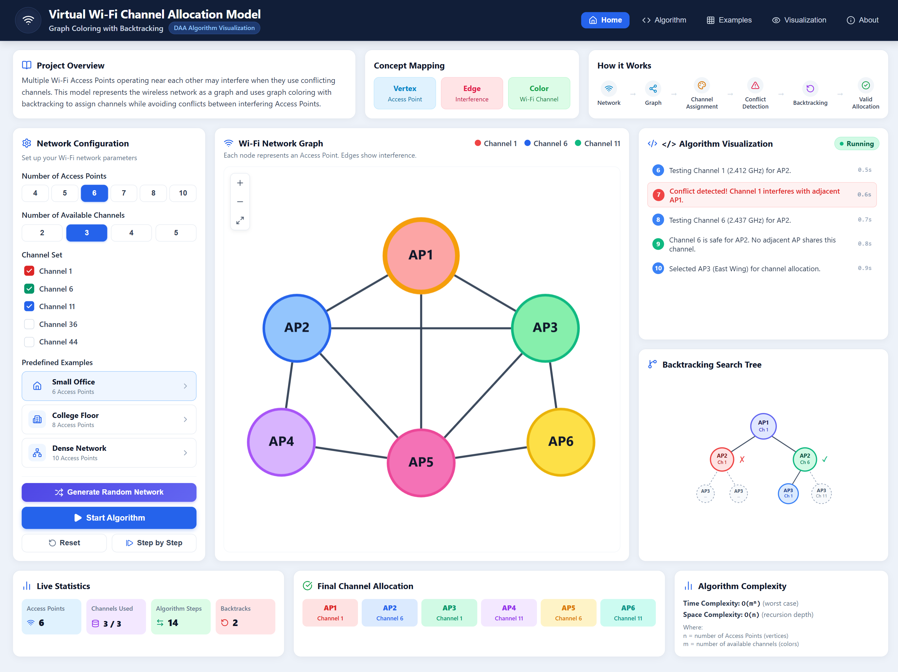
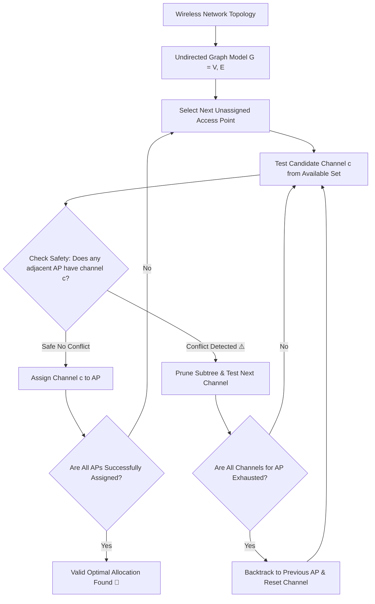
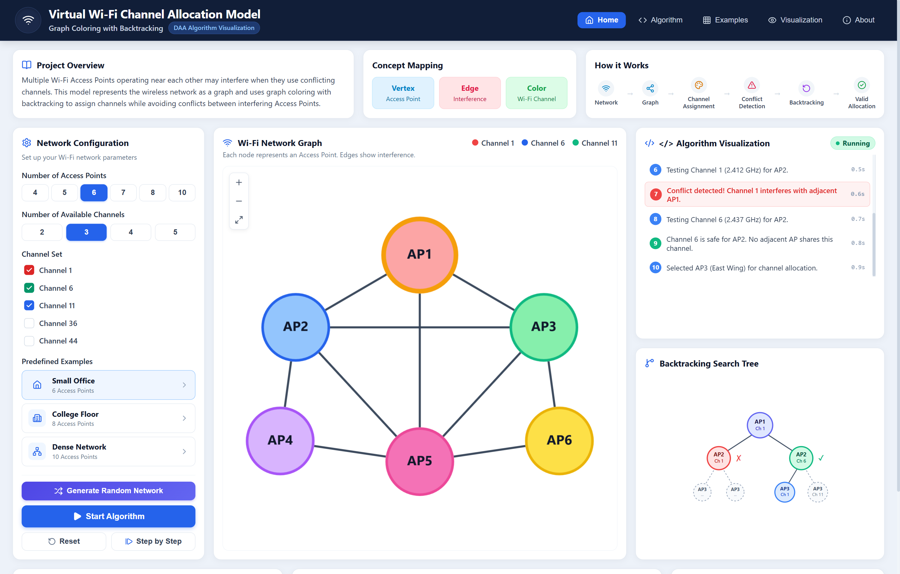
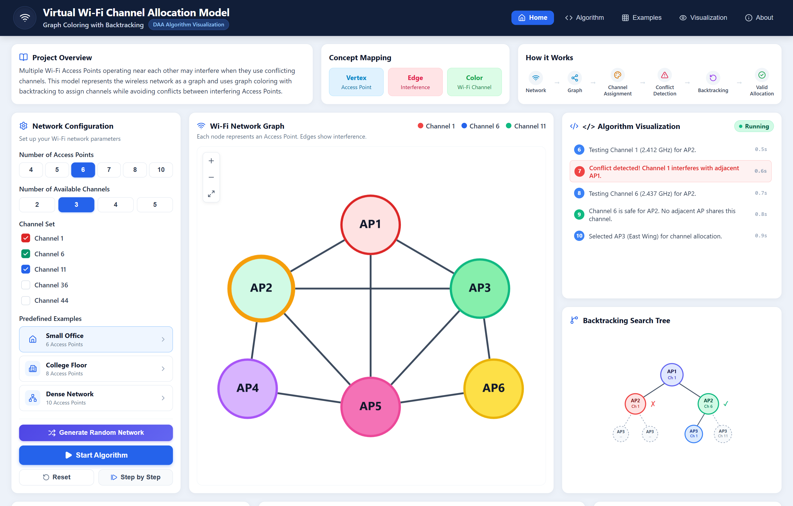
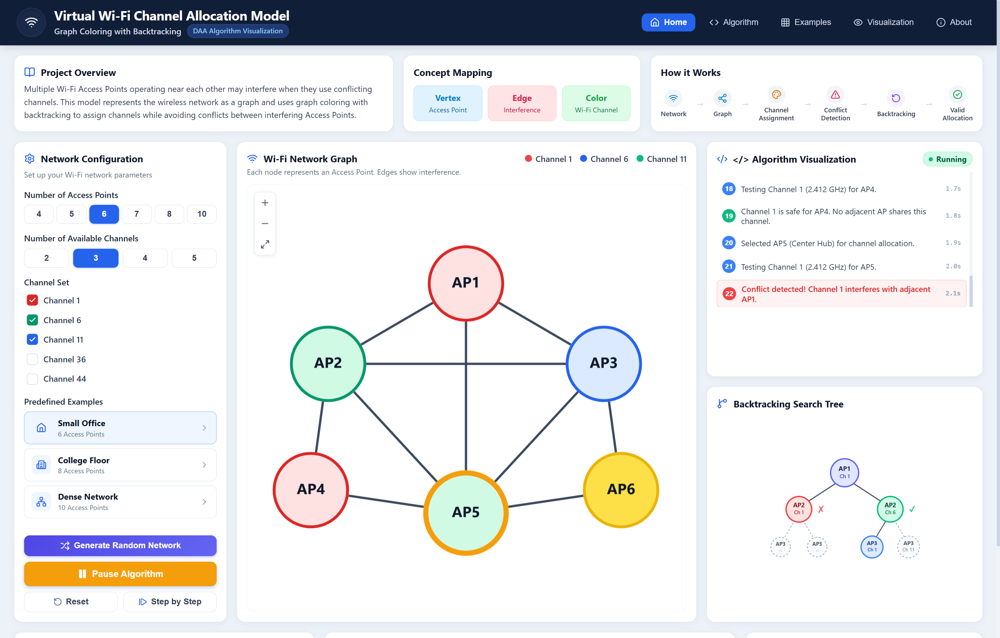
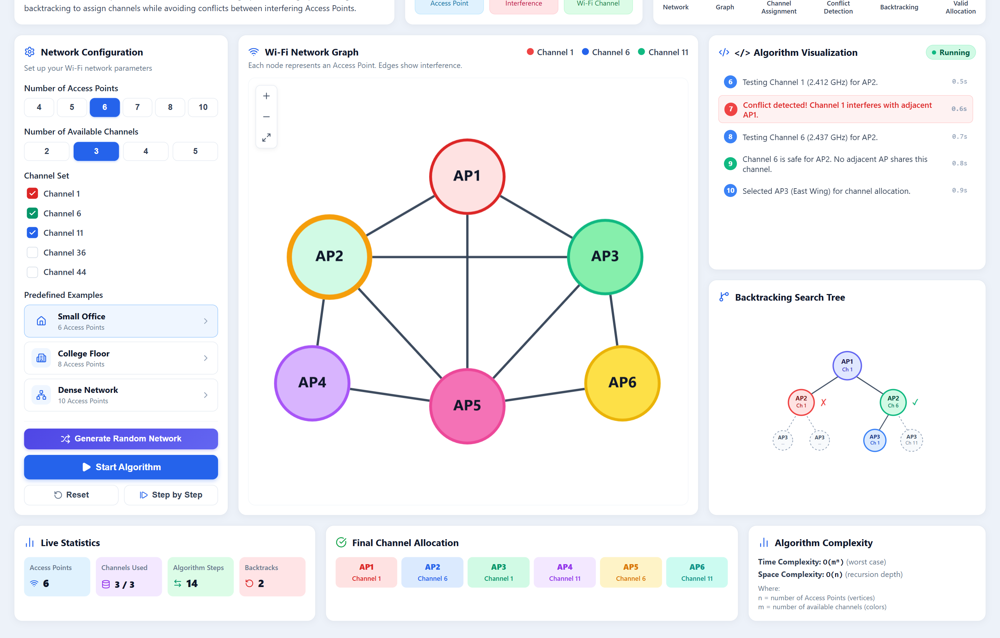
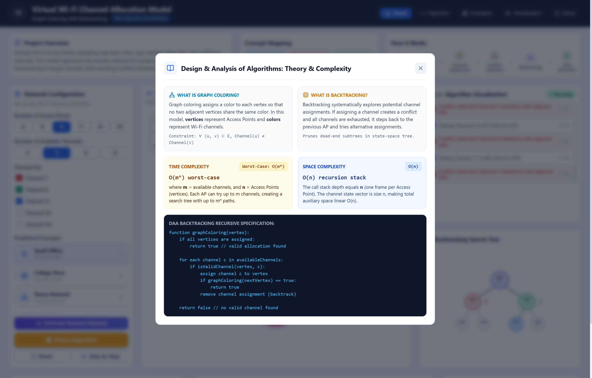

<div align="center">

# 📡 Virtual Wi-Fi Channel Allocation Model
### Graph Coloring with Recursive Backtracking & Conflict Pruning

[](https://react.dev/)
[](https://www.typescriptlang.org/)
[](https://vitejs.dev/)
[](https://js.cytoscape.org/)
[](LICENSE)
[](https://github.com/AdityaxDeore)

<p align="center">
  <b>An interactive, real-time Design and Analysis of Algorithms (DAA) visualization tool that models dense wireless local area networks (WLAN) as undirected graphs and computes optimal, collision-free Wi-Fi channel allocations using Graph Coloring with Recursive Backtracking.</b>
</p>

[Explore Features](#-key-features) •
[Algorithm Theory](#-mathematical--algorithmic-formulation) •
[Screenshots](#-visual-walkthrough) •
[Installation](#-getting-started) •
[Contributor](#-contributor)

---

</div>

## 🖼️ Application Preview

<div align="center">
  
</div>

---

## 📖 Overview

In modern multi-AP wireless environments (offices, university campuses, convention halls), adjacent Wi-Fi Access Points operating on identical or overlapping frequency channels suffer from **Co-Channel Interference (CCI)**. This causes packet collisions, latency spikes, and degraded network throughput.

This project maps this real-world networking challenge into a fundamental problem in computer science: the **$m$-Coloring Graph Problem**.

By treating each Access Point as a graph vertex and each interference range as an undirected edge, we use **Recursive Backtracking with Constraint Satisfaction** to find a conflict-free channel allocation using the minimum necessary frequency channels (chromatic number $\chi(G)$).

---

## 🎯 DAA Problem Mapping

| Graph Theory Element | Wireless Networking Equivalent | Description |
| :--- | :--- | :--- |
| **Vertex ($V$)** | **Wi-Fi Access Point (AP)** | Independent transmitter node placed at $(x, y)$ coordinate space |
| **Edge ($E$)** | **Interference Range (CCI)** | Collision boundary between two APs within physical signal overlap |
| **Color ($C$)** | **Wi-Fi Frequency Channel** | Non-overlapping spectrum channels (e.g., 2.4 GHz Channels 1, 6, 11) |
| **Constraint** | **Zero Co-Channel Collision** | $\forall (u, v) \in E \implies \text{Channel}(u) \neq \text{Channel}(v)$ |
| **Objective** | **Feasible Channel Allocation** | Assign valid channels to all $|V|$ APs using available channel pool $m$ |

---

## 🔄 Algorithm Execution Pipeline



---

## ✨ Key Features

- **Interactive Cytoscape.js Graph Canvas**:
  - Drag-and-drop AP vertex repositioning with live coordinate recomputation.
  - Active vertex pulse animations and real-time edge conflict highlighting in high-contrast red.
  - Color-coded channel badges directly mapped to Wi-Fi frequency bands.

- **Dynamic Backtracking Search Tree**:
  - Visual decision tree rendering the recursive search space step-by-step.
  - Distinct node states: current trial, pruned branches ($\times$), validated assignments ($\checkmark$), and explored states.

- **Granular Execution Controls**:
  - **Start / Pause**: Automatic animated traversal with adjustable tick speed.
  - **Step-by-Step**: Inspect individual recursive stack calls, channel tests, and backtrack triggers.
  - **Reset**: Instantly restore the system to its initial unassigned state.

- **Configurable Network Environments**:
  - Dynamic AP count selector ($4$ to $10$ nodes).
  - Channel spectrum pool selector ($2$ to $5$ non-overlapping channels: Ch 1, 6, 11, 36, 44).
  - Randomized topology generator producing unique planar interference graphs.
  - **Predefined Scenarios**:
    - *Small Office* (6 APs, 3 Channels)
    - *College Floor* (8 APs, 4 Channels)
    - *Dense Network* (10 APs, 5 Channels)

- **Comprehensive Real-Time Metrics**:
  - Live step counter and backtrack frequency tracker.
  - Per-AP channel assignment breakdown cards.
  - Interference safety verification engine.

---

## 📸 Visual Walkthrough

### 1. Interactive Topology & Configuration Workstation
> Configure AP density, available frequency channels, and pre-built network layouts with real-time graph rendering.

<div align="center">
  
</div>

<br />

### 2. Live Backtracking & Conflict Detection
> Watch the algorithm detect co-channel collisions in real-time, prune invalid decision subtrees, and trigger recursive backtracking.

<div align="center">
  
</div>

<br />

### 3. Optimal Conflict-Free Channel Allocation
> Full network convergence where all adjacent Access Points operate on orthogonal frequencies with zero interference.

<div align="center">
  
</div>

<br />

### 4. Live Performance Analytics & Allocation Matrix
> Real-time step counter, backtrack frequency, channel distribution summary, and collision audit.

<div align="center">
  
</div>

<br />

### 5. Algorithmic Theory & Complexity Breakdown
> In-depth theoretical modal detailing state-space exploration, recurrence relations, and asymptotic bounds.

<div align="center">
  
</div>

---

## 🧮 Mathematical & Algorithmic Formulation

### Recursive Backtracking Specification

```typescript
function graphColoring(vertexIndex: number): boolean {
  // Base case: All vertices have been assigned valid colors
  if (vertexIndex === totalVertices) {
    return true;
  }

  const currentVertex = vertices[vertexIndex];

  // Iterate through all candidate channels (colors)
  for (const channel of availableChannels) {
    if (isValidChannel(currentVertex, channel)) {
      assignments[currentVertex.id] = channel; // Assign color

      // Recurse to assign the next vertex
      if (graphColoring(vertexIndex + 1)) {
        return true;
      }

      // Backtrack: Undo assignment if downstream leads to conflict
      assignments[currentVertex.id] = null;
    }
  }

  return false; // No valid color exists for this path
}

function isValidChannel(vertex: Vertex, channel: number): boolean {
  for (const neighbor of getNeighbors(vertex)) {
    if (assignments[neighbor.id] === channel) {
      return false; // Co-channel interference conflict
    }
  }
  return true;
}
```

### Complexity Analysis

- **Time Complexity**:
  - **Worst Case**: $\mathcal{O}(m^n)$ where $n = |V|$ (number of Access Points) and $m$ is the count of available channels. In the worst case without pruning, the decision tree branches $m$ times at each level of depth $n$.
  - **Average Case with Pruning**: Significantly faster than $\mathcal{O}(m^n)$ due to early conflict detection ($k$-consistency pruning) which discards incompatible subtrees immediately.

- **Space Complexity**:
  - $\mathcal{O}(n)$ auxiliary recursion stack space. The maximum recursion depth is bounded by the number of vertices $|V|$. The state vector storing assignments is also of size $\mathcal{O}(n)$.

---

## 🛠️ Tech Stack & Architecture

- **UI & Core**: [React 19](https://react.dev/), [TypeScript](https://www.typescriptlang.org/)
- **Bundler & Tooling**: [Vite 8](https://vitejs.dev/)
- **Graph Visualization**: [Cytoscape.js](https://js.cytoscape.org/)
- **Styling**: High-performance Vanilla CSS Design System with dark glassmorphism and Tailwind tokens
- **Iconography**: [Lucide React](https://lucide.dev/)
- **Micro-Interactions**: [Canvas Confetti](https://www.kirilv.com/canvas-confetti/)

```
daa-fa/
├── docs/
│   └── screenshots/              # High-resolution application screenshots
├── src/
│   ├── algorithm/
│   │   └── backtrackingEngine.ts # Precomputing trace, state snapshots & recursive engine
│   ├── components/
│   │   ├── BacktrackingSearchTree.tsx    # Decision tree visualizer
│   │   ├── AlgorithmVisualizationLog.tsx # Live execution event feed
│   │   ├── NetworkGraph.tsx              # Cytoscape interactive topology
│   │   ├── SidebarConfig.tsx             # Controls, presets, AP & channel selectors
│   │   ├── BottomMetrics.tsx             # Live statistics and final allocation cards
│   │   ├── ComplexityExplanation.tsx     # DAA complexity modal
│   │   ├── Header.tsx                    # Navigation & branding
│   │   └── OverviewCards.tsx             # Vertex/Edge/Color DAA mapping cards
│   ├── constants/
│   │   ├── channels.ts           # Standard Wi-Fi 2.4/5 GHz channel definitions
│   │   └── presets.ts            # Network layouts (Small Office, College, Dense)
│   ├── types/
│   │   └── index.ts              # Strongly typed interfaces & data contracts
│   ├── utils/
│   │   └── graphGenerator.ts     # Planar random network topology generator
│   ├── App.tsx                   # Main orchestrator component
│   └── main.tsx                  # Root mount entrypoint
├── package.json
└── README.md
```

---

## 🚀 Getting Started

### Prerequisites

Ensure you have **Node.js** (version 18.0 or newer) installed:

```bash
node -v
npm -v
```

### Installation

1. **Clone the repository**:
   ```bash
   git clone https://github.com/AdityaxDeore/Network-Visualiser-graph.git
   cd Network-Visualiser-graph
   ```

2. **Install project dependencies**:
   ```bash
   npm install
   ```

3. **Start the development server**:
   ```bash
   npm run dev
   ```
   Open your browser and navigate to `http://localhost:5173`.

4. **Build for production**:
   ```bash
   npm run build
   npm run preview
   ```

---

## 👨‍💻 Contributor

<div align="center">
  <table>
    <tr>
      <td align="center">
        <a href="https://github.com/AdityaxDeore">
          <br />
          <sub><b>Aditya Deore</b></sub>
        </a><br />
        <sub>Lead Developer & Algorithm Designer</sub><br />
        <a href="https://github.com/AdityaxDeore" title="GitHub">💻 @AdityaxDeore</a>
      </td>
    </tr>
  </table>
</div>

---

## 📄 License

This project is licensed under the **MIT License** — feel free to use, modify, and distribute for educational and academic purposes.

<div align="center">
  <sub>Built with ❤️ for Design and Analysis of Algorithms (DAA)</sub>
</div>
